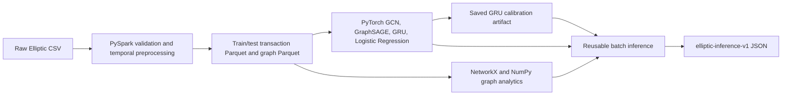

# Elliptic++ Transaction Graph Analytics

This repository explores chronological machine-learning and graph-analytics
methods for identifying illicit activity in the Elliptic Bitcoin transaction
dataset. It is a research/preprocessing project, not a production enforcement
system. Transaction labels are class 1 (illicit), class 2 (licit), and class 3
(unknown).

## Dataset and evaluation protocol

The expected raw files are `data/raw/elliptic/txs_features.csv`,
`data/raw/elliptic/txs_classes.csv`, and
`data/raw/elliptic/txs_edgelist.csv`. The validated dataset has 203,769
transactions, 234,355 directed edges, and 182 numeric transaction features.
Seventeen supplied features each have 965 missing values. Missing values are
preserved in the processed Parquet files. Model transforms use medians learned
from their permitted fitting period; no arbitrary global or test-fitted fill is
used.

The held-out transaction split is chronological:

| Period | Timesteps | Role / row count |
|---|---:|---|
| Selection fitting | 1–30 | Supervised epoch-selection fit |
| Validation | 31–34 | Chronological epoch selection |
| Final fit period | 1–34 | 136,265 transaction rows; class 3 excluded from loss |
| Held-out test | 35–49 | 67,504 transactions |

Class 3 can remain as unlabeled graph/context data and can receive model
outputs, but it is excluded from supervised metrics. The labeled test support
is 16,670 transactions: 15,587 licit and 1,083 illicit (6.4967% illicit).

## Architecture and technologies



Preprocessing uses PySpark to join the feature and class tables, split at
timestep 34, and persist transaction and graph Parquet. Models use PyTorch;
NumPy/PyArrow support feature and Parquet processing. Graph summaries use
NumPy and NetworkX 3.7 Louvain. The inference interface reuses saved
checkpoints/transforms, calibration, and graph-analytics CSVs; it does not
retrain or regenerate those artifacts.

The current WSL environment was checked with Python 3.14.4, PyTorch
2.13.0+cu132 (CUDA 13.2; CUDA available), PyArrow 26.0.0, PySpark 4.2.0, and
NetworkX 3.7. Java is required by local Spark. These are observed environment
versions, not a pinned cross-platform dependency lockfile.

## Saved model results

The following are the saved held-out metrics summarized in
[`models/comparison_report.md`](models/comparison_report.md). Metrics exclude
class 3; precision/recall/F1 use the fixed 0.5 cutoff. Average precision is the
non-interpolated illicit-class PR area.

| Model | Illicit precision | Recall | F1 | Average precision | Confusion matrix (licit row, illicit row) |
|---|---:|---:|---:|---:|---|
| GCN | 0.3662 | 0.5420 | 0.4371 | 0.4461 | `[[14571, 1016], [496, 587]]` |
| GraphSAGE | 0.3166 | 0.5402 | 0.3992 | 0.5055 | `[[14324, 1263], [498, 585]]` |
| Temporal GRU | 0.3555 | 0.7655 | 0.4855 | 0.7266 | `[[14084, 1503], [254, 829]]` |
| GRU calibrated risk | 0.4997 | 0.7276 | 0.5925 | 0.7022 | `[[14798, 789], [295, 788]]` |
| Logistic Regression | 0.2115 | 0.7664 | 0.3315 | 0.4739 | `[[12493, 3094], [253, 830]]` |

Test illicit prevalence is 6.4967%; all saved average-precision results exceed
that reference. The risk-score result is Platt-calibrated GRU output, not an
independently trained future-risk target. Calibration used timesteps 31–34,
which were also used for GRU epoch selection; this can make calibration
assessment optimistic. The report and per-model JSON files under each
`artifacts/` directory contain configurations and fuller metrics.

The GCN uses two symmetrically normalized graph-convolution layers.
GraphSAGE uses a two-layer mean-neighbor aggregator. The temporal GRU processes
per-timestep mean feature summaries and combines the causal recurrent state
with each node's features. Logistic Regression is a single linear classifier.
The calibrated-risk component applies saved Platt coefficients to the
validation-selected GRU; it is the GRU's illicit score with calibration, not a
fifth independently trained neural architecture.

## Graph analytics

Existing outputs are under `models/graph_analytics/artifacts/`:

- `node_graph_statistics.csv`: per-node directed in/out degree, undirected
  degree, neighborhood degree mean, weak-component membership, and community.
- `component_summaries.csv`: 49 weak components, totaling 203,769 nodes and
  234,355 directed edges.
- `community_summaries.csv`: 311 Louvain communities; saved modularity is
  0.979571 (unweighted undirected projection, resolution 1.0, seed 2026).
- `suspicious_transactions.csv`: 67,504 test-period ranking rows, with
  as-of-timestep graph context and the existing GRU risk score.

Full-graph degree, component, and community fields are descriptive and include
later-timestep graph structure. They must not be presented as historical
features available at each transaction's timestep. The suspicious-connection
heuristic is separately identified and uses same/earlier-timestep scored
neighbors. It is a ranking measure, not a calibrated probability, causal
explanation, or decision threshold. Graph analytics does not read labels.

## WSL environment and commands

Use the existing Ubuntu WSL distribution and project environment; no package
installation is needed for the verified workflow:

```bash
wsl -d Ubuntu
cd /mnt/d/BDE_Project/EllipticPlusPlus-Project
source ~/.venvs/elliptic-plus/bin/activate
```

In this WSL environment, PyTorch imports require the process-scoped workaround
`TORCH_USE_RTLD_GLOBAL=1`. It avoids the known CUDA library-preloader conflict
without changing system environment settings. Use it on every command that
imports PyTorch, including tests and inference:

```bash
TORCH_USE_RTLD_GLOBAL=1 python -m unittest tests.test_inference tests.test_preprocessing_invariants tests.test_graph_analytics -v
```

The graph-analytics command is:

```bash
python -m models.graph_analytics.analyze_graph
```

It reads existing Parquet and risk-score files and writes/overwrites graph
analytics artifacts. Do not run it merely to test the project; use the focused
tests above for checks that do not regenerate those outputs.

## Batch inference

The reusable API is `models.inference.EllipticInference`; the CLI writes a
versioned JSON file and refuses to overwrite an existing destination. A small
sample (one supported ID and one deliberate unknown ID) is:

```bash
TORCH_USE_RTLD_GLOBAL=1 python -m models.inference --model gcn --tx-ids 13385567 -1 --output "$HOME/elliptic-inference/sample.json"
```

The model argument can be `gcn`, `graphsage`, `gru`, or `logistic`. Each output
record includes the selected model probability/prediction and the separate
calibrated GRU risk, plus graph statistics, community, and suspicious rank
where present. Status values are `scored`, `unknown_transaction_id`, and
`unsupported_timestep`; unavailable fields are JSON `null`, never a fabricated
zero.

To score all 67,504 known test-period transactions for one selected model:

```bash
TORCH_USE_RTLD_GLOBAL=1 python -m models.inference --all-test --model gcn --output "$HOME/elliptic-inference/gcn-test.json"
```

The full batch was not run as part of testing. The documented planning estimate
for GCN is 2–5 minutes, about 1–2 GB host memory, hundreds of MB GPU memory
when CUDA is active, and a 70–100 MB indented JSON file; this is an estimate,
not a benchmark. Each command scores one selected classifier and includes the
same risk/graph fields.

### JSON schema and visualization handoff

The top-level schema version is `elliptic-inference-v1`. It contains
`requested_model`, `supported_timesteps`, `population`, `record_count`,
`status_counts`, `graph_scope`, and `records`. Each record contains `txId`,
`Time step`, `status`, `requested_model`, `model_output`, `risk`,
`graph_statistics`, `community`, and `suspicious_connection`. Consume the
`schema_version` before rendering; preserve `null` as unavailable and use
`status` to distinguish unsupported IDs. Keep the full-graph scope label visible
in any visualization and render suspicious heuristic score separately from
calibrated illicit probability. The inference interface supports only known
transactions in this fixed dataset; it does not ingest or score unseen nodes.

See [`models/INFERENCE.md`](models/INFERENCE.md) for the full field-level
contract and [`models/graph_analytics/README.md`](models/graph_analytics/README.md)
for algorithms and graph-statistic interpretation.

## Reproducibility and limitations

The neural baselines use seed 2026 and validation timesteps 31–34 for epoch
selection; final model fits use labeled timesteps 1–34 and report on 35–49.
Feature medians, centers, and scales are fitted on the relevant training period
and saved with the checkpoints. Risk calibration reuses the GRU validation
period, as described above. No test labels enter inference.

Graph and GRU evaluation use same-timestep transductive context, not strictly
online prediction. The supplied `Aggregate_feature_*` columns' upstream
provenance is not established in this repository. Full-graph analytics contains
future topology relative to earlier transactions. Class-3 transactions can
receive scores, but their ground truth is unavailable and their outputs are not
validated calibrated probabilities. Wallet identity, mixer proximity, and
causal explanations are not present in these data or inferred by this project.

Raw data (`data/raw/`), processed data (`data/processed/`), and generated model
artifacts (`models/*/artifacts/`) are excluded by `.gitignore`. Checkpoints and
results are local artifacts and must be present to run inference. No dashboard,
web API, or incremental unseen-transaction scoring is implemented in this
phase.
